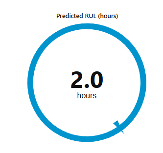
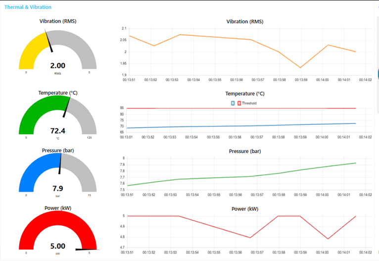
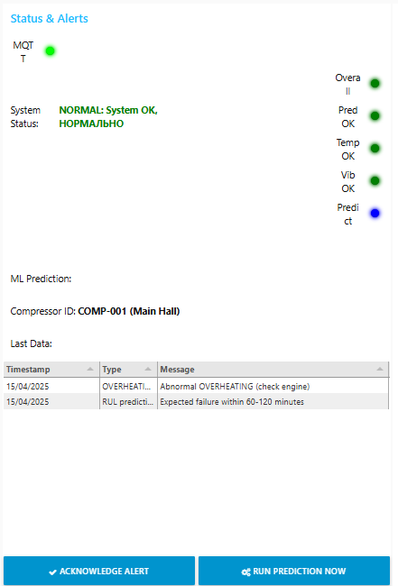
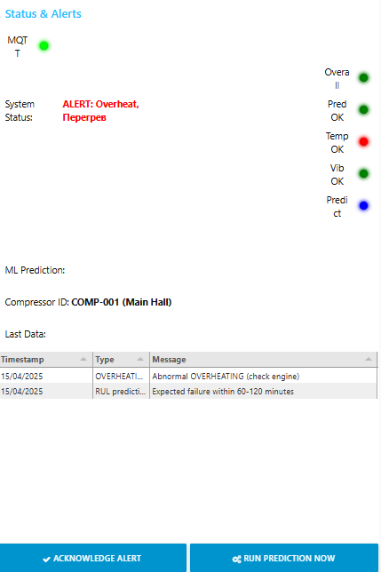
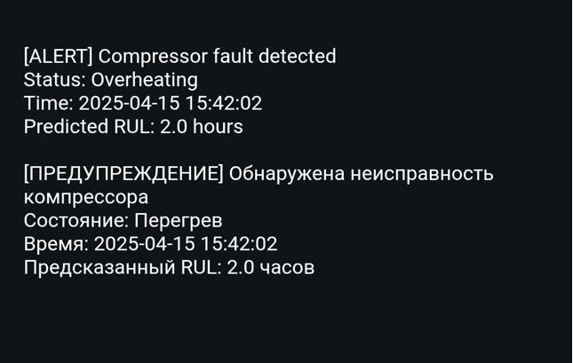

# Predictive Maintenance for an Agricultural Seeding Machine

A Master's project prototype for monitoring the compressor and pneumatic system of a seedling machine. It combines MQTT telemetry, Node-RED, Python machine-learning inference, MySQL storage, a monitoring dashboard, and alerts.

## System architecture

The project used **Qubitro** as its cloud IoT/MQTT platform. The documented cloud exchange uses Node-RED MQTT OUT to publish telemetry and MQTT IN to receive topic data. The Node-RED export in `flows/flows.json` contains the local monitoring and persistence path: Mosquitto at `localhost:1883` and MySQL at `localhost:3306`, with telemetry and prediction history stored in `compressor_data` and `rul_predictions`.

The Raspberry Pi environment used Raspberry Pi OS in VMware. CSV replay and synthetic telemetry were used to exercise the monitoring flow; the project did not use a physical Raspberry Pi or live sensors. The screenshots below are figures from the Master's thesis.

CSV replay and synthetic telemetry were used to exercise the monitoring flow. The screenshots below are figures from the Master's thesis.

## Repository contents

| Path | Contents |
|---|---|
| `flows/flows.json` | Node-RED monitoring, inference, dashboard, MySQL storage, and alert flow |
| `database/schema.sql` | MySQL schema for sensor history and RUL predictions |
| `scripts/predict_fault.py` | 12-feature fault classification inference |
| `scripts/predict_ttf.py` | 160-feature time-to-failure / remaining-useful-life inference |
| `scripts/simulate.py` | CSV telemetry publisher |
| `scripts/simulate_sensor_data_final2.py` | Alternate CSV telemetry publisher |
| `scripts/simulatet.py` | Synthetic MQTT telemetry publisher |
| `scripts/simulate_sensor_data_final.py` | Command-line fault-classification variant |
| `data/data.csv` | 100,000-row telemetry replay dataset |
| `data/ttf.csv` | 50,000-row telemetry dataset with `time_to_failure` labels |
| `models/xgboost_model_v3.pkl`, `models/xgboost_scaler_v3.pkl` | Paired fault-classification model and scaler |
| `models/xgboost_multiclass_rul_prediction_ttf_240min_enhanced_tuned.json`, `models/scaler_multiclass_ttf_240min_enhanced_focused_tuned.pkl` | Paired RUL model and 160-feature scaler |
| `notebooks/master_training_analysis.ipynb` | Exploratory analysis and model-training experiments |
| `docs/images/` | Dashboard and email-alert figures from the thesis |

## Telemetry and model flow

The CSV replay publishers read rows and publish sensor fields as JSON on MQTT topic `compressor/data`. The synthetic publisher generates sensor-like values and publishes them to the same topic. Node-RED routes telemetry to the dashboard and the fault-classification script. A scheduled branch retrieves recent rows from MySQL, writes a temporary CSV history, and invokes the RUL script.

The fault classifier uses 12 input features. The RUL model expects 160 engineered features; its matching scaler is included. The supplied training notebook records several analysis and training experiments across compressor datasets.

## Dashboard figures

### RUL gauge

### Telemetry trends

### Machine status

| Normal status | Overheat status |
|---|---|
|  |  |

### Email alert

## Setup

Install Python dependencies from `requirements.txt`, Node-RED and its MQTT, MySQL, dashboard, and email nodes. Start Mosquitto and MySQL, run `database/schema.sql`, then import `flows/flows.json` into Node-RED for the local monitoring path.

The flow uses local file paths relative to the repository root. Start Node-RED from the repository directory. Keep broker and email credentials in Node-RED's credential settings and outside the repository.

The model and data paths in the Python scripts are resolved from the repository. `predict_ttf.py` reads recent sensor history from `data/data_history.csv`; Node-RED generates this file from stored telemetry before invoking the script.
